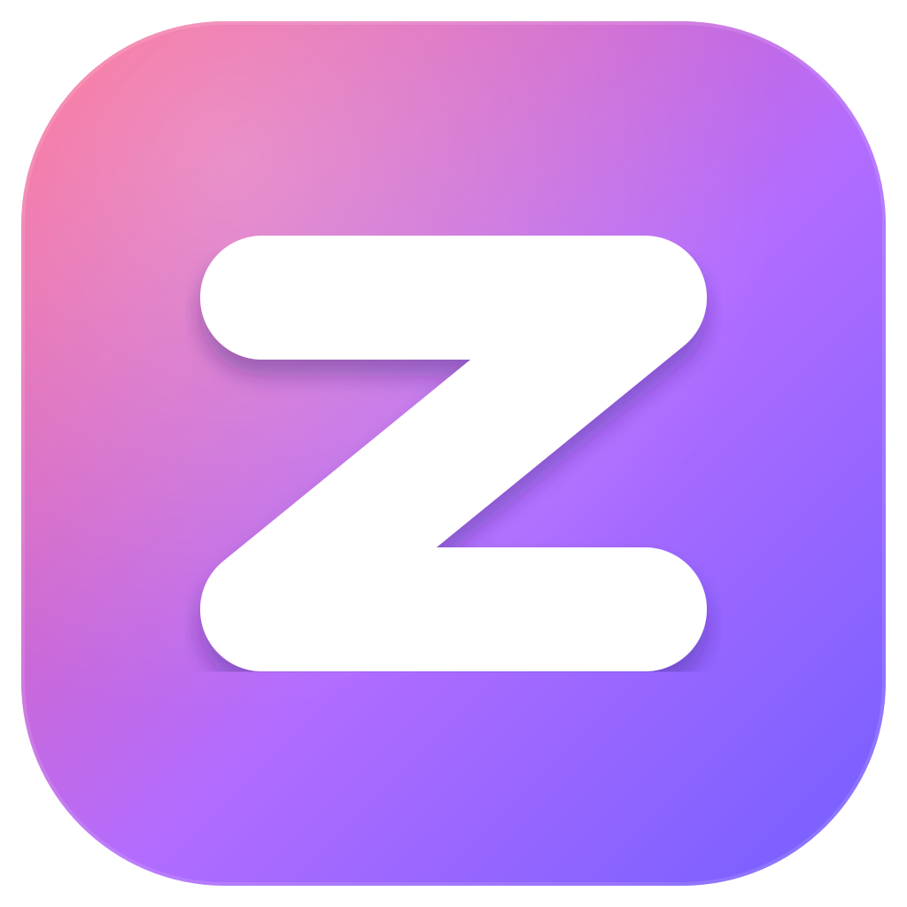

<p align="center"></p>

# Zefaro

**Yet Another Local Laravel Tools**

Zefaro is a free, open-source local PHP development environment for Windows, and an
alternative to XAMPP and Laragon. Link a project folder and Zefaro serves it at
`name.test` on the PHP version you choose, with HTTPS, databases and a mail catcher
already set up.

**Website:** [zefaro.pages.dev](https://zefaro.pages.dev) ·
[Bahasa Indonesia](https://zefaro.pages.dev/id/) ·
[Download](https://github.com/andikatuluspangestu/zefaro/releases/latest)

Every feature is free. Zefaro has no accounts and no analytics, and by design it has no
AI features and no cloud features. It is built with Tauri v2, React and TypeScript,
and a Rust engine downloads, configures and supervises the services.

Zefaro is an independent project and is not affiliated with Laravel.

### Panduan dalam Bahasa Indonesia

- [Alternatif XAMPP untuk belajar PHP dan Laravel](https://zefaro.pages.dev/id/alternatif-xampp/):
  perbandingan dan cara pindah dari htdocs.
- [Alternatif Laragon yang gratis dan open source](https://zefaro.pages.dev/id/alternatif-laragon/):
  cara pindah dari folder www Laragon.
- [Aplikasi gratis untuk mahasiswa IT](https://zefaro.pages.dev/id/aplikasi-mahasiswa-it/):
  memulai PHP, Laravel, dan database di laptop sendiri.

## Install

1. Download `Zefaro_<version>_x64-setup.exe` from the
   [Releases page](https://github.com/andikatuluspangestu/zefaro/releases).
2. Optional: compare the file with the SHA-256 in `SHA256SUMS.txt`. In PowerShell,
   run `Get-FileHash .\Zefaro_<version>_x64-setup.exe -Algorithm SHA256`.
3. Run the installer. It isn't code-signed yet, so Windows SmartScreen may say
   "Windows protected your PC". Click **More info**, then **Run anyway**.
4. In Zefaro, open **Services**, install PHP, click **Start all** and set up the DNS
   rule. Home shows what's left to do. Then link a folder on **Sites**.

You need Windows 10 or 11 (64-bit). Installing takes no administrator rights, and
Windows asks for them once, when you set up the `.test` DNS rule. The installer
downloads the Microsoft Edge WebView2 Runtime if it's missing. Zefaro uses ports 80 and
443, so quit XAMPP, Laragon or IIS first, or choose other ports in
nginx's settings.

To update, run a newer installer over the old one. Your sites, settings and databases
stay where they are. To uninstall, use **Settings, Apps, Installed apps** in Windows.
The uninstaller removes Zefaro's PATH entry, the DNS rule and the trusted certificate
authority, and keeps `%USERPROFILE%\.config\zefaro` until you delete that folder.

## What Zefaro does

| Area | What you get |
|---|---|
| Home | The first page: which services run, your sites with a button to open each, and what needs attention (a service that failed, the DNS rule, an untrusted certificate, PATH). A fresh install gets a four-step checklist. |
| Appearance | Light and dark themes in the Zefaro palette. Zefaro follows Windows by default; **Settings** lets you pick either. |
| Sites | A linked folder is served at `name.test`, subdomains included. A `public/` folder becomes the document root, and pretty URLs work. Zefaro shows which framework each folder holds, and **New site** makes a Laravel app with any official starter kit, a database and HTTPS. |
| Site tools | Each Laravel site has its own page: an overview that fixes common `.env` problems with a button, a read-only data browser (edits on request), `.env`, `config()` values and routes, the app's logs, a Tinker session that keeps its variables, Artisan commands as forms, and workers (queue, scheduler, Vite) that Zefaro keeps running. Buttons open the site in the editors, terminals and database tools found on the computer. |
| HTTPS | One click per site. Zefaro runs its own local certificate authority, which can only sign for `.test` names. Its key is encrypted for your Windows account, and you trust it in Windows' own confirmation dialog. PHP trusts it too, so one local site can call another over HTTPS. |
| PHP | Versions 7.4 to 8.5 side by side, from the official Windows builds, each with its own limits. Composer and the Laravel installer live in Zefaro's own `COMPOSER_HOME`. |
| Node.js | The Current line and every maintained LTS line from nodejs.org. You pick the active version for `node`, `npm`, `npx` and `corepack`. |
| DNS | Zefaro's built-in DNS server answers `*.test` (or `*.internal`). A Windows name resolution rule sends those lookups to it, so there is no hosts file to edit. |
| Databases | MariaDB 11.8 LTS, PostgreSQL 18, Redis 8.10 and phpMyAdmin 5.2 at `phpmyadmin.test`. The Databases page creates, drops, exports and imports databases, streaming dumps to and from disk so they don't have to fit in memory. The live test round-trips 1 GB. |
| Mail | Mailpit 1.32 catches every email your apps send on `127.0.0.1:1025`, and PHP's `mail()` is pointed at it. The Mail page has search, attachments, links and an unread count. |
| Logs | A live viewer for the nginx, PHP, MariaDB, Redis and Mailpit logs, with search and a level filter. |
| Services | One page starts and stops everything. Zefaro restarts a service that crashes. Closing the window keeps Zefaro and its services running in the system tray; quitting from the tray stops them all in order, with nginx first and the databases last. |
| Command line | Once you add Zefaro's folder to PATH, `php`, `composer`, `laravel`, `node`, `npm`, `npx`, `mariadb`, `mysql`, `mariadb-dump`, `mysqldump`, `mariadb-admin`, `psql`, `pg_dump`, `pg_restore`, `createdb`, `dropdb` and `redis-cli` work in any terminal and connect to Zefaro's own servers. `nginx` accepts `-t`, `-T`, `-v`, `-V` and `-s reload`. |
| Settings pages | nginx (ports, workers, timeouts, request size, gzip, HTTP/2, logs, extra directives), PHP per version, DNS, Mailpit. |

Every program Zefaro downloads comes from its project's official source and is checked
before use. The hashes for nginx, MariaDB, PostgreSQL, Redis, phpMyAdmin and Mailpit are
built into Zefaro. For PHP, Node.js and Composer, Zefaro checks the hash each project publishes.

Zefaro keeps its settings, programs and data in `%USERPROFILE%\.config\zefaro`. Every
service listens on `127.0.0.1` only. The built-in documentation is under **Help,
Documentation**, and Ctrl+K searches it.

## Develop

You need Node.js with npm, the Rust MSVC toolchain and the Microsoft C++ Build Tools.
Tauri needs the Microsoft Edge WebView2 Runtime, which Windows 11 and Microsoft Edge include.

```bash
winget install Rustlang.Rustup
```

```bash
winget install Microsoft.VisualStudio.2022.BuildTools --override "--quiet --add Microsoft.VisualStudio.Workload.VCTools --includeRecommended"
```

After installing Rust, run `rustup default stable-x86_64-pc-windows-msvc`. Then:

```bash
npm install
npm run tauri dev     # opens the Zefaro window with hot reload
```

To work on the interface without compiling Rust:

```bash
npm run build         # tsc + vite build
```

To test the engine:

```bash
cd src-tauri
cargo test --lib
```

Tests marked `#[ignore]` are live tests. They download software and bind real ports, so
run them with `cargo test --lib -- --ignored <name>` only on a machine where that is fine.

`src-tauri/.cargo/config.toml` limits Cargo to two parallel jobs, because builds ran out
of memory on an 8 GB machine. Raise `jobs` if you have more RAM.

## Architecture

```
React UI  ──invoke()──▶  Tauri commands (Rust)  ──▶  engine
 src/                     src-tauri/src/commands       src-tauri/src/engine
  App.tsx (shell)          sites, php, node            supervisor (Job Objects)
  api.ts (typed invoke)    services, nginx, dns        nginx, php-cgi, MariaDB, Redis,
  pages/*                  certs, db, mail, logs       Mailpit, DNS server, local CA,
                           tools, system               logs, CLI shims, downloads
```

- `src/` is the interface. `api.ts` holds every command name, pages call `api.*`, and
  `types.ts` mirrors the Rust model.
- `src-tauri/src/commands/` has thin Tauri handlers over `AppState`.
- `src-tauri/src/engine/` does the work: installs, process supervision, config
  generation, DNS, certificates, database dumps.
- `src-tauri/src/config.rs` saves your settings to `~/.config/zefaro/config.json`.
- `video/` is the Remotion project for the promo video. Its README has the details.
- `DESIGN.md` records the design direction the interface follows.

## Build the installer

```bash
npm run build:installer
```

Use this command, not `npm run tauri build`, for anything you share. It strips the build
machine's paths, which include your Windows user name, out of `zefaro.exe` (see
`scripts/build-installer.mjs`). The installer lands in
`src-tauri/target/release/bundle/nsis/Zefaro_<version>_x64-setup.exe`. It is NSIS only (see
`bundle` in `src-tauri/tauri.conf.json`) and:

- installs per user (`installMode: currentUser`), so it needs no admin rights, and puts
  Zefaro in `%LOCALAPPDATA%\Zefaro`;
- shows `src-tauri/installer/sidebar.bmp` (164×314) and `header.bmp` (150×57), drawn from
  the app icon;
- runs `src-tauri/installer/hooks.nsh` on uninstall, which calls `uninstall-cleanup.ps1`
  (shipped next to `Zefaro.exe`) to remove Zefaro's PATH entry, the `.test` DNS rule and the
  trusted certificate authority. It skips this during updates. To test the script
  safely, pass `-PathValueName <dummy value> -DryRun`;
- uses thin LTO in the release profile, because fat LTO with one codegen unit ran out of
  memory on 8 GB machines;
- isn't code-signed, so SmartScreen warns on first run. Once you have a certificate, sign
  with `bundle.windows.certificateThumbprint` or `signCommand`.

## Change the icon

The icon's source is `src-tauri/icons/app-icon.svg`. After editing it:

1. Run `npm run tauri icon src-tauri/icons/app-icon.svg`, then delete the generated
   `android/` and `ios/` folders.
2. Copy the SVG to `public/zefaro.svg`.
3. Update `src/components/logo.tsx`, which draws the same artwork, and the logo in
   `video/src/components/Logo.tsx`.
4. Run `npm run installer-art` in `video/` to redraw the installer's `sidebar.bmp` and
   `header.bmp`.

## Website

The landing page at zefaro.pages.dev lives in `site/` (React, Vite and Framer Motion). See
[site/README.md](site/README.md) to run, build and publish it.

## Changes

[CHANGELOG.md](CHANGELOG.md) lists what changed in each release.

## Contributing

Contributions are welcome. Read [CONTRIBUTING.md](CONTRIBUTING.md) first. Zefaro accepts
no AI features of any kind and no cloud features, and pull requests that add them are
closed without review.

## Licence and trademarks

Zefaro is released under the [MIT License](LICENSE), © 2026 Zefaro contributors.

The software Zefaro downloads (nginx, PHP, Node.js, Composer, MariaDB, Redis, phpMyAdmin,
Mailpit) comes from each project's official source and keeps its own licence. The About
page lists them. Service logos come from Dashboard Icons (Apache-2.0), and each logo is
its project's trademark.
